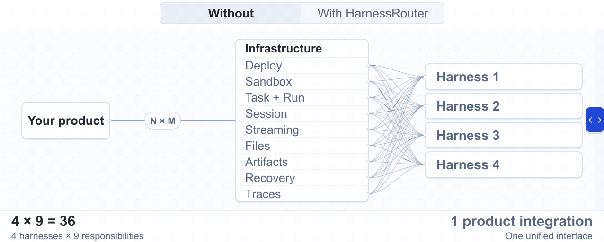
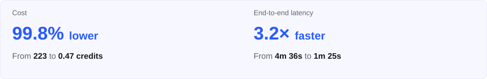
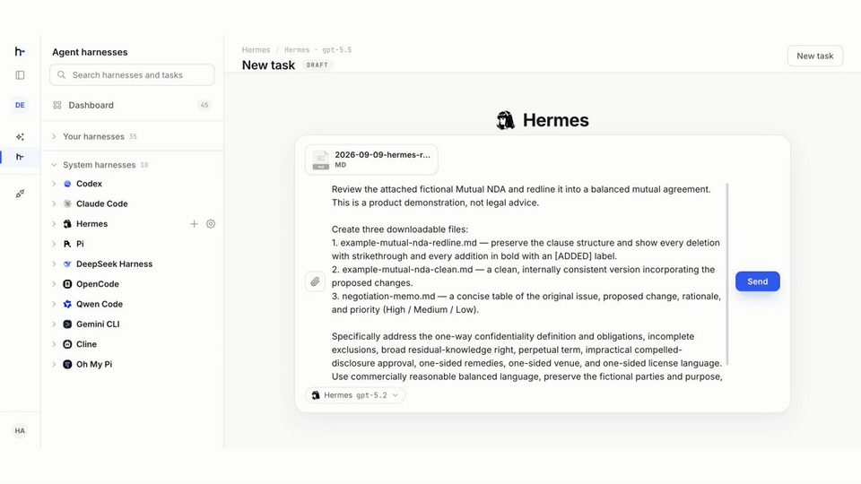
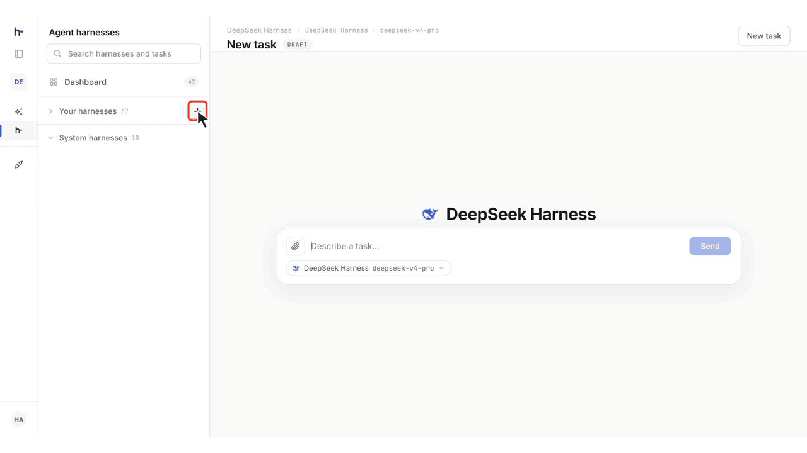
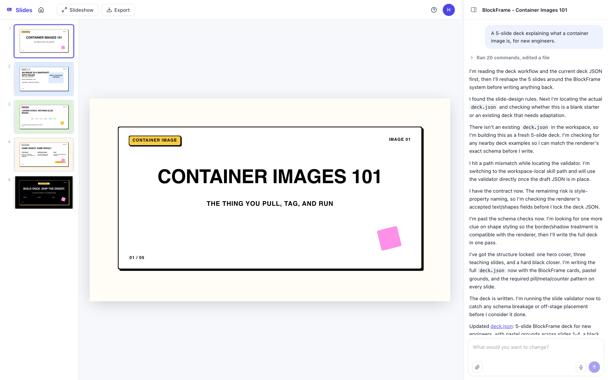
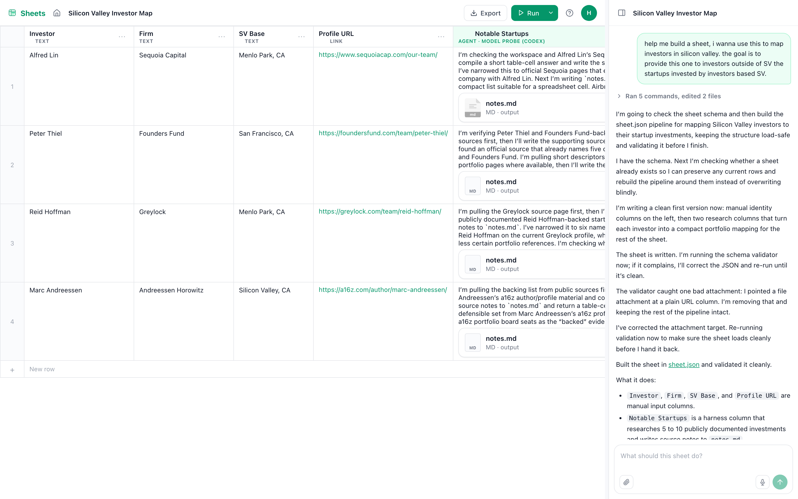
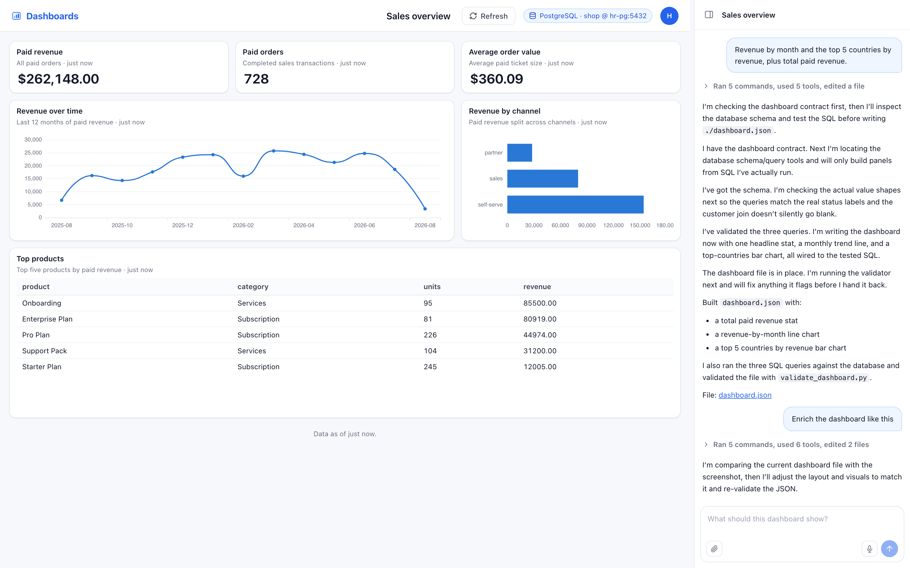
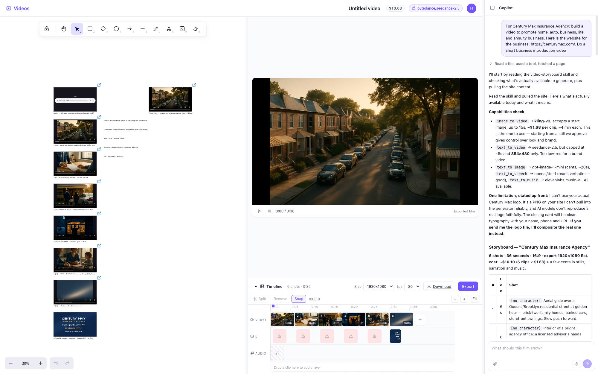
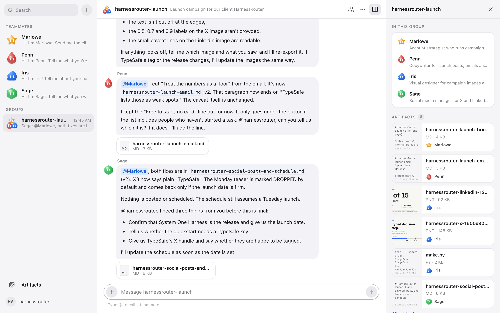

> **[中文化] harnessrouter**
>
> 此项目是 [HarnessRouter/harnessrouter](https://github.com/HarnessRouter/harnessrouter) 的中文翻译版本。
> - 原项目 Stars: 2993
> - 主语言: Python
> - 许可证: Apache-2.0
> - 翻译日期: 2026-10-14
> - 原始 README: [README_en.md](README_en.md)
>
> 说明：下方 README 正文为**原项目文档的中文翻译**，力求忠于原文；本页顶部的「中文快速上手」为**面向中文用户的补充导读**（非原文内容），目的是让你不用读完整篇 README 就能先把项目跑起来。
>
> 如有翻译不准确之处，欢迎提 Issue 或 PR。

---


## 🚀 中文快速上手（补充导读，非原文）

### 这是什么 / 解决什么问题

HarnessRouter 是一个「agent harness 的统一接口」基础设施层。它把 Codex、Claude Code 这类已有的 harness 变成即插即用的 agent 后端，让你的产品通过一个 API 就能运行任务、取回结果、切换 harness。它实现了 Unified Harness Protocol (UHP)，并提供兼容 OpenAI Responses 的 API，负责处理持久会话、流式进度、文件、产物、取消和结构化失败。

### 快速上手（最短路径）

1. 启动 HarnessRouter（需已安装 Docker）：

```bash
docker run -d --name harnessrouter \
  -p 127.0.0.1:3000:3000 \
  -v harnessrouter:/data \
  harnessrouter/harnessrouter
```

2. 等待首次启动完成（首次启动会安装启用的 harness CLI）：

```bash
docker logs -f harnessrouter
```

当日志出现 `[harnessrouter] ready on :3000` 时继续。按 Ctrl+C 停止跟踪日志，容器会继续运行。

3. 打开控制台 [http://localhost:3000](http://localhost:3000)，使用默认凭据登录：用户名 `harnessrouter`，密码 `harnessrouter`。

4. 在侧边栏打开 **Bring Your Own Key**，点击 **Add Integration**，选择 provider、命名并填入其 API key，其支持的模型即可在控制台中使用。

（原文 README 前 7000 字在此处截断，后续步骤原文未说明。）

### 环境要求

- 操作系统：原文未说明（仅给出 Docker 运行方式）。
- 硬件：约 4 GB 磁盘空间。
- 依赖：Docker；一个 provider API key。
- 版本要求：原文未说明。
- 国内网络环境提示：原文未提及镜像源或加速下载相关内容，如需可自行考虑更换 Docker 镜像源。

### 常见坑与注意事项

- 需要自备 provider API key：无需 HarnessRouter 账号，也没有捆绑的模型或试用 key。
- 首次启动会安装 harness CLI，需要等待；若控制台未就绪或某个 harness 缺失，可查看日志中的 `backends available:` 及 `requested but not installed` 警告。
- 不要加 `--user`：entrypoint 和 Runner 需要 root 来管理每会话用户。
- 默认密码必须修改：登录后应在 Profile 中修改默认密码，修改前保持实例仅本地可访问；保存会短暂重启控制台并登出其他浏览器。

---


---

<h1 align="center">
  <a href="https://harnessrouter.ai/open-source">
    <picture>
      <source media="(prefers-color-scheme: dark)" srcset=".github/images/logo-dark.png">
      
    </picture>
  </a>
<br>
Agent harness 的统一接口。
</h1>

<p align="center">
<a href="https://github.com/HarnessRouter/harnessrouter#top" title="Back to the top to star this repository"></a>
  <a href="LICENSE"></a>
  <a href="https://hub.docker.com/r/harnessrouter/harnessrouter"></a>
  <a href="protocol/conformance"></a>
  <a href="#the-unified-harness-protocol"></a>
</p>

**无需处理 harness 工程，即可构建 agent 产品。** HarnessRouter 是基础设施层，把 Codex、Claude Code 等现有 harness 变成即插即用的 agent 后端，让你的产品通过一个 API 运行任务、获取结果、切换 harness。

<a href="https://github.com/HarnessRouter/harnessrouter#top" title="Back to the top to star this repository">
  <picture>
    <source media="(max-width: 600px)" srcset="docs/images/github-readme-star-cta-mobile.svg">
    
  </picture>
</a>

<a id="what-it-is"></a>

<a id="one-integration"></a>



HarnessRouter 实现了 [Unified Harness Protocol (UHP)](#the-unified-harness-protocol)，并提供兼容 OpenAI Responses 的 API，处理持久会话、流式进度、文件、构建产物、取消和结构化失败。

<a id="one-interface-the-freedom-to-choose"></a>

## 切换 harness。优化成本与延迟。

<picture>
  <source media="(max-width: 600px)" srcset="docs/images/benchmark-summary-mobile.svg">
  
</picture>

同一任务上的八种 harness × 模型配置。每项指标对比其最佳与最差结果。成本最低和速度最快的配置因任务而异。[方法论](https://harnessrouter.ai/benchmarks)

> [!TIP]
> **开始使用：**[本地运行](#quickstart) · [集成到你的产品](#use-the-api-directly) · [入门套件](#starter-kits) · [使用托管 Cloud](https://harnessrouter.ai)

<a id="install"></a>

<br>

## 快速开始

在你自己掌控的基础设施上，用你自己的提供商密钥自托管社区版。

一条 Docker 命令启动，等待首次启动完成，然后连接模型提供商并运行第一个任务。

<a id="what-you-need"></a>

**你需要：** Docker · 约 **4 GB** 磁盘 · 一个**提供商 API 密钥**

无需 HarnessRouter 账号，也不附带模型或试用密钥。

### 1. 启动 HarnessRouter

```bash
docker run -d --name harnessrouter \
  -p 127.0.0.1:3000:3000 \
  -v harnessrouter:/data \
  harnessrouter/harnessrouter
```

Docker 会按需拉取镜像。命名卷在重启之间保留数据库、文件、已安装的 harness CLI 和工作区。

<details>
<summary>已有安装或自定义设置</summary>

**已经安装过？** `docker pull harnessrouter/harnessrouter` 只下载最新镜像，不会升级正在运行的容器。请遵循[升级与备份指南](docs/self-hosting-guide.md#restarts-upgrades-and-backups)。

**3000 端口被占用？** 改用 `-p 127.0.0.1:3100:3000`，并打开 3100 端口。使用初始凭据期间请保持回环绑定。

**不要添加 `--user`。** 入口脚本和 Runner 需要 root 来管理每会话用户。Console 和 Gateway 以非特权身份运行；agent 进程以各自会话的用户身份运行。

版本固定、Compose 和脚本化设置，参见[设置指南](docs/self-hosting-guide.md#install)。

</details>

### 2. 等待首次启动

```bash
docker logs -f harnessrouter
```

首次启动会安装已启用的 harness CLI。日志出现以下内容后继续：

```text
[harnessrouter] ready on :3000
```

按 **Ctrl+C** 停止跟踪日志。容器会继续运行。

<details>
<summary>Console 未就绪或缺少 harness？</summary>

如果浏览器拒绝连接，等几秒后重试，Console 可能还在启动。若缺少 harness，检查日志中的 `backends available:` 和 `requested but not installed` 警告。

</details>

### 3. 打开控制台

打开 [http://localhost:3000](http://localhost:3000)（或你选择的主机端口），然后登录：

<table><tbody><tr><th scope="row">用户名</th><td><code>harnessrouter</code></td></tr><tr><th scope="row">密码</th><td><code>harnessrouter</code></td></tr></tbody></table>

> [!WARNING]
> **请在 Profile 中修改默认密码。** 修改前请保持实例仅本地可访问。保存会短暂重启 Console，并登出其他浏览器。

<details>
<summary>查看登录界面</summary>


</details>

使用已有卷或自定义凭据？[查看凭据优先级与设置](docs/self-hosting-guide.md#install)。

这些凭据用于登录 Console。在此运行任务不需要 HarnessRouter API 密钥。

### 4. 连接模型提供商

打开侧边栏的 **Bring Your Own Key**，点击 **Add Integration**。选择提供商，为集成命名，添加其 API 密钥。其支持的模型随后可在 Console 中使用。

此提供商密钥用于授权模型请求，与下文产品集成所用的 HarnessRouter API 密钥不同。

<details>
<summary>查看提供商设置界面</summary>


</details>

### 5. 运行第一个任务

打开 **Agent harnesses**，选择一个受支持的 harness，点击 **New task**。选择可用模型，给 agent 一个具体任务。跟踪实时进度，并在同一会话中打开它生成的文件。



<sub>在上面的示例运行中，Hermes 审阅一份虚构的 NDA，并生成修订版、干净副本和谈判备忘录。</sub>

<a id="configure-a-custom-harness"></a>

### 配置自定义 harness（可选）

内置 harness 无需此步骤。当你需要为产品定制可复用行为时，创建自定义 harness。

1. **创建。** 在 **Agent harnesses** 中选择 **New harness**。在 **Add harness** 中同时设置 **Name**、**Base harness** 和 **Default model**，然后选择 **Create and configure**。
2. **定制。** 在 **Harness Settings** 中添加 **Agent instructions**，配置 **Tools**（可选用 **Add MCP** 添加 MCP 服务器），并按需添加 **Skills**。
3. **保存并测试。** 选择 **Save Changes**，然后 **Run Task** 测试保存的配置。

默认模型之后可在 Settings 中修改，但基础 harness 创建后无法更改。

<details>
<summary>观看配置演示 · 48 秒</summary>



<sub>为客户反馈分析配置 DeepSeek Harness。</sub>

</details>

<a id="using-the-api"></a>

<a id="use-the-api-directly"></a>

<a id="integrate-into-your-product-with-one-api"></a>

<a id="integrate-into-your-product-backend-with-one-api"></a>

<br>

## 用一个 API 把 harness 集成到你的产品后端

将内置或自定义 harness 作为可插拔 agent 后端来运行产品任务。调用你自托管实例的兼容 OpenAI Responses 的 API，并通过 `metadata.harness_id` 选择 harness。无需 Cloud 部署。

当 harness 在 Console 中成功运行后：

1. 在同一 CE 实例的 Console 侧边栏打开 **API Keys**（[默认本地地址](http://localhost:3000/keys)），选择 **Create API key**。
2. 将仅显示一次的密钥保存为产品后端中的 `HARNESSROUTER_API_KEY`。切勿在浏览器代码中暴露。此 CE 签发的密钥与 Console 密码和提供商密钥不同。
3. 使用 Console 中显示的 Harness ID 和已连接提供商提供的模型调用 API。

```bash
export HARNESSROUTER_BASE_URL=http://localhost:3000/api/harness

curl --fail-with-body -sS "$HARNESSROUTER_BASE_URL/v1/responses" \
  -H "Authorization: Bearer ${HARNESSROUTER_API_KEY:?}" \
  -H 'content-type: application/json' \
  -d '{
    "input":"Reply with exactly: it works.",
    "metadata":{"harness_id":"codex"},
    "model":"gpt-5.4-mini",
    "stream":false
  }'
```

任务及其记录会出现在 Console 的同一工作区中。设置 `"stream": true` 可接收服务器发送事件。

切勿在提示词中放入 token、id 或哈希这类较长的精确值：agent 会重新输入它读到的内容，而模型会在这类字符串中丢字换字。请将其作为文件附加（`POST /v1/files`，然后使用 `input_file` 块；文件会在每次携带它的轮次前以其文件名落到 agent 的工作目录），或通过 harness 的环境变量交给 agent。harness 接受一个 `env` 映射，其值在每轮解析：`$headers.X-Name` 从请求中取该请求头（需在 `additional_headers` 中声明），`vault:name` 取已存储的密钥，其他值按原样使用。agent 的 shell 和工具启动时已设置这些变量，因此任务可以说“token 在 $DEPLOY_TOKEN 中”，而通过引用传入的值会从离开沙箱的一切内容中脱敏，包括响应、流、trace 和存储记录，即使 agent 打印它也一样。`vault:` 引用只能读取你自己工作区通过 `PUT /v1/mcp-secrets/{ref}` 存储的密钥。脱敏保护的是记录，不是 agent：agent 能读到的值，如果提示词或页面要求，它也能发到别处，所以请给它一个限定到该用户和该任务、短期有效、最小权限的 token。

完整 API 描述位于 `$HARNESSROUTER_BASE_URL/v1/openapi.json`，由路由生成，可在 `/v1/docs` 浏览。

当后端和 CE 运行在同一台计算机上时，默认 URL 可用。从其他机器或容器访问时，请使用 CE 实例可达的 URL。[阅读完整的自托管 API 与网络指南 →](docs/self-hosting-guide.md#using-the-api)

<a id="one-interface-for-the-agent-lifecycle"></a>

<table>
        <thead><tr><th scope="col">你的应用可以…</th><th scope="col">方式</th></tr></thead>
        <tbody>
          <tr><th scope="row">启动任务</th><td>发送指令并检查执行状态</td></tr>
          <tr><th scope="row">继续会话</th><td>用 <code>previous_response_id</code> 发送后续指令</td></tr>
          <tr><th scope="row">流式进度</th><td>在 agent 工作时接收实时更新</td></tr>
          <tr><th scope="row">处理文件</th><td>附加输入文件并获取生成的输出</td></tr>
          <tr><th scope="row">取消任务</th><td>停止不再需要的工作</td></tr>
          <tr><th scope="row">检查执行</th><td>查看结构化错误和执行 trace</td></tr>
        </tbody>
      </table>

<a id="starter-kits"></a>

<br>

## 把 agent harness 作为产品的可插拔后端

用 agent harness 为你的产品提供 agent 能力，包括创建内容、分析数据等知识工作任务。探索这些开箱即用的套件，了解 harness 作为可插拔后端的实际效果。

<table>
  <tr>
    <td width="50%" valign="top">
      
      <h3>Slides</h3>
      <p>agent harness 将你的简要说明转化为幻灯片内容和布局，生成可编辑的演示文稿。</p>
    </td>
    <td width="50%" valign="top">
      
      <h3>Sheets</h3>
      <p>agent harness 使用每行数据执行任务，并将结果写回表格。</p>
    </td>
  </tr>
  <tr>
    <td width="50%" valign="top">
      
      <h3>Dashboards</h3>
      <p>agent harness 读取你的数据库 Schema，编写 SQL 查询为仪表盘图表提供数据。</p>
    </td>
    <td width="50%" valign="top">
      
      <h3>Videos</h3>
      <p>agent harness 将你的简要说明转化为分镜计划，并调用视频工具为时间线生成片段。</p>
    </td>
  </tr>
  <tr>
    <td width="50%" valign="top">
      
      <h3>My Workplace</h3>
      <p>招聘 harness 面试你，并把每位队友安装为独立的 harness；队友分组协作，互相传递文件和 @提及，并将成果留在共享库中。</p>
    </td>
    <td width="50%" valign="top"></td>
  </tr>
</table>

[**探索入门套件 →**](https://github.com/HarnessRouter/starter-kit)

<details>
<summary>设置说明与许可</summary>

**开始：** 在 Console 中打开 **Starter Kits**，选择已连接提供商支持的 harness 和模型。

**Dashboards：** 使用可达的数据库和只读数据库账号。设置 `HR_SECRET_KEY` 加密存储的连接，并在连接前检查示例行设置。

**许可：** 入门套件使用与社区版[不同的条款](https://github.com/HarnessRouter/starter-kit#licensing)。

[设置指南 →](docs/self-hosting-guide.md#starter-kits)

</details>

<br>

## 部署选择

<a id="why-self-host-community-edition"></a>

<a id="why-self-host"></a>

### 自托管，掌控一切

- **你的基础设施。** 一次 Docker 部署即可运行 Console、Gateway 和 Runner。
- **你的凭据和状态。** 提供商密钥、会话、文件和工作区都由你掌控。模型请求仍发往你配置的提供商。
- **真实工作区。** 原生文件系统、shell 和 Git 工作流，会话工作区相互隔离。
- **无 Console 产品分析。** 社区版禁用 Console 分析流水线。

<a id="local-to-cloud"></a>

<a id="cloud-heading"></a>

### 选择你的 Cloud 路径

选择 **HarnessRouter Cloud** 获得托管部署、