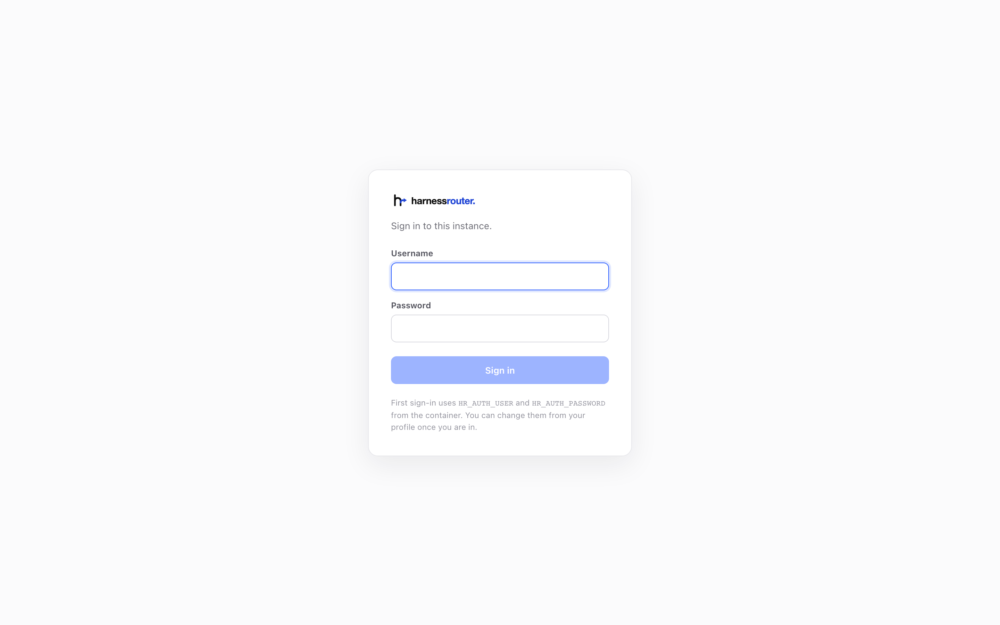
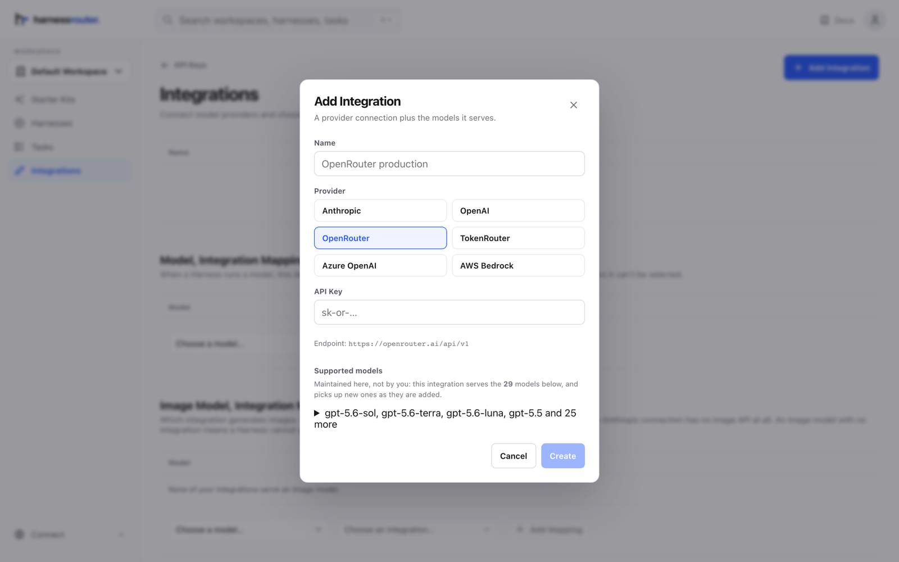

# 社区版安装与运维

详细的安装、配置、API 和部署说明。如需更简短的五步流程，请从 [README 快速开始](../README.md#quickstart)入手。本指南将拉取镜像与启动容器分为两步，因此安装流程共六步。

## 目录

- [安装](#install)
- [重启、升级与备份](#restarts-upgrades-and-backups)
- [删除会移除什么，以及何时移除](#what-a-delete-removes-and-when)
- [入门套件](#starter-kits)
- [插件](#plugins)
- [环境](#environments)
- [这是什么](#what-it-is)
- [为什么自托管](#why-self-host)
- [统一 Harness 协议](#the-unified-harness-protocol)
- [配置](#configuration)
- [使用 API](#using-the-api)
- [部署到公网 URL](#putting-it-on-a-public-url)
- [迁移到托管服务](#moving-to-the-hosted-service)
- [架构](#architecture)
- [资源](#resources)
- [许可证](#license)

## 安装

共六步，完成后你将拥有一个运行中的实例、一个已登录的控制台，以及一个已回复你的 agent。

你需要 Docker、约 4 GB 磁盘空间，以及一个模型提供商的 API 密钥。无需创建账号，也无需注册。首次登录后还需设置本地控制台密码。模型请求使用你配置的提供商和凭据。

### 1. 拉取镜像

```bash
docker pull harnessrouter/harnessrouter
```

下载约 700 MB。

<details>
<summary>固定版本而非使用 <code>latest</code></summary>

`latest` 跟踪当前发布版本。拉取会下载镜像，但不会更新已有容器；请遵循[升级步骤](#restarts-upgrades-and-backups)。使用版本标签可指定某个发布版本，使用镜像摘要可确保获得完全相同的镜像。发布版本列在 [Docker Hub](https://hub.docker.com/r/harnessrouter/harnessrouter/tags) 上。

</details>

### 2. 运行

原样复制即可。其中没有任何占位符——没有提供商密钥，也没有密码。

```bash
docker run -d --name harnessrouter \
  -p 127.0.0.1:3000:3000 \
  -v harnessrouter:/data \
  harnessrouter/harnessrouter
```

如果端口 3000 已被占用，只改左边的数字（`-p 127.0.0.1:3100:3000`），因为容器内部始终监听 3000。

<details>
<summary>这一行中每一部分的作用</summary>

`-p 127.0.0.1:3000:3000` 使控制台只能从本机访问。正因如此，才能用默认登录信息启动，之后再修改。

`-v harnessrouter:/data` 是所有持久数据所在之处：数据库、你的文件，以及首次启动时安装的 agent CLI。保留该卷是后续每次启动都很快的原因。

没有提供商密钥，因为你在第 5 步从控制台连接提供商。这是更短的路：粘贴到表单中的密钥不会被拼错进 shell 历史，之后修改也无需重建容器。

没有密码，因为实例以默认登录信息启动，第 4 步会提供给你并要求你修改。

</details>

<details>
<summary>不要添加 <code>--user</code>：容器以 root 启动并自行降权</summary>

容器必须以 root 启动，从 0.8.2 起，以其他方式启动会被拒绝，并输出一行说明。这不是常见的"以 root 运行"捷径，恰恰相反。需要 root 只为一件事：每个 agent CLI 都以各自的会话用户运行，该用户拥有该会话的工作区，仅此而已。入口脚本和 Runner 保留 root 以管理这些用户。Console 和 Gateway 以非特权用户运行；每个 agent 进程在其会话用户下运行。

在一个服务多个会话的容器内，这带来以下好处：

- 一个 agent 无法读写另一个会话的文件、数据库、blob 存储或密钥存储。不是"被告知不要"，而是无法做到，因为这些路径属于其他用户。
- agent 保存到错误位置的文件会在写入时失败，此时模型还在，可以自行纠正，而不是悄悄消失在被收集的工作区之外。
- agent 进程的环境变量中不包含产品的任何密钥。

实现这一点没有授予额外权限：没有 `--privileged`、没有 `--cap-add`、没有自定义 seccomp 配置文件。Docker 的默认能力集已包含 root 进程切换到其他用户所需的能力，仅此而已。

如果你目前使用 `--user` 运行（或 compose 文件中的 `user:`），请在升级前移除。上面记录的命令从未设置过它，任何早期版本的卷都会在首次启动时原地沿用。

</details>

<details>
<summary>在 <code>docker run</code> 时自定义用户名和密码</summary>

两个可选变量。设置后它们会替换默认值；控制台不会再向你显示默认登录信息。

```bash
docker run -d --name harnessrouter \
  -p 127.0.0.1:3000:3000 \
  -v harnessrouter:/data \
  -e HR_AUTH_USER=you \
  -e HR_AUTH_PASSWORD=the-password-you-chose \
  harnessrouter/harnessrouter
```

`HR_AUTH_PASSWORD=` 后面写什么，**就是**密码——第 4 步用完全相同的内容登录。开始使用并不需要这样做，之后从个人资料页修改密码同样可行；它适用于由脚本构建、无人会打开浏览器的机器。

</details>

<details>
<summary>改用 Docker Compose</summary>

在仓库根目录的检出中运行这些命令，`docker-compose.yml` 和 `.env.example` 就在那里。启动前，将 [`docker-compose.yml`](../docker-compose.yml) 中发布的端口从 `3000:3000` 改为 `127.0.0.1:3000:3000`。然后将 `.env.example` 复制为 `.env` 并运行 `docker compose up -d`。

</details>

### 3. 等待就绪提示

**先不要打开浏览器。** `docker run` 大约一秒就返回提示符，但控制台还需要约半分钟，在此之前 <http://localhost:3000> 会拒绝连接。这是首次启动仍在进行，不是容器损坏。

```bash
docker logs -f harnessrouter
```

等待 `ready on :3000`，然后打开浏览器：

```
[harnessrouter] installing Claude Code (Anthropic's terms apply)…
[harnessrouter] installing opencode (MIT)…
[harnessrouter] installing Qwen Code (Apache-2.0)…
[harnessrouter] installing Gemini CLI (Apache-2.0)…
[harnessrouter] installing Cline (Apache-2.0)…
[harnessrouter] installing Codex (Apache-2.0)…
[harnessrouter] installing Pi (MIT) and its MCP adapter (MIT)…
[harnessrouter] installing Oh My Pi (MIT)…
[harnessrouter] installing goose (Apache-2.0)…
[harnessrouter] installing DeepSeek Harness (MIT, developer preview — version-pinned)…
[harnessrouter] installing Hermes (check its upstream license before use)…
[harnessrouter] data=/data  backends available: claude codex hermes pi dsh opencode qwen gemini cline omp goose kimi grok
[harnessrouter] ready on :3000
```

已安装的 CLI 缓存在卷上，因此后续启动通常更快。新的或之前失败的后端仍可能触发安装。按 **Ctrl+C** 停止跟踪日志；这不会停止容器。如果就绪行之后控制台仍无法立即访问，请等几秒后重试，让其服务器完成启动。

<details>
<summary>其他行，以及为什么首次启动最慢</summary>

`backends available:` 列出实际安装成功的内容，因此失败的后端会被点名而非悄悄缺失，其他后端仍可正常工作。

你还会看到下面这行，它在每次启动时都会出现，直到你在第 4 步修改密码。在仅回环的实例上，这是提醒而非问题：

```
[harnessrouter] WARNING: using the DEFAULT password. Set HR_AUTH_PASSWORD, or change it from the profile page, before exposing this instance.
```

启用的 agent CLI 在首次启动时从上游获取，而非打包在镜像中。每个仍受其上游许可证和条款约束；本仓库的 Apache 2.0 许可证不能替代它们。使用前请查阅 [NOTICE](../NOTICE) 及各工具的条款。运行实例的目录反映实际可用的后端。

</details>

### 4. 登录

打开 <http://localhost:3000>，或你在第 2 步选择的主机端口，使用以下信息登录：

| | |
|---|---|
| 用户名 | `harnessrouter` |
| 密码 | `harnessrouter` |



**立即修改密码**，从账户菜单的 **Profile** 进入。保存会短暂重启 Console。

如果你在 `docker run` 时设置了 `HR_AUTH_USER` 或 `HR_AUTH_PASSWORD`，请改用它们登录——默认值此时会被拒绝。

这些凭据用于登录 Console。在其中运行任务不需要 HarnessRouter API 密钥。稍后[集成产品后端](#using-the-api)时再创建。

<details>
<summary>密码存放在哪里，忘记了怎么办</summary>

在此处打印默认值，正是它们成为占位符而非密钥的原因，这也是容器在你修改密码前每次启动都警告的原因。

个人资料页要求同时输入当前密码和新密码，因此无人看管的标签页无法用来接管实例。新凭据存储在数据卷上（`/data/selfhost-auth.json`：用户名、盐和哈希，从不存密码），此后优先于环境变量——几个月前在 `docker run` 时设置的 `HR_AUTH_PASSWORD` 无法悄悄撤销密码修改。修改后，启动行会变为说明真实密码的来源：

```
[harnessrouter] sign in as 'harnessrouter' (credentials set from the profile page)
```

保存还会登出所有其他浏览器。你自己的保持登录。

忘记了？没有重置邮件可发，因此删除 `/data/selfhost-auth.json` 并重启。实例会回退到 `HR_AUTH_USER` / `HR_AUTH_PASSWORD`。

</details>

### 5. 连接模型提供商

**不做这一步，什么都不会运行。** 镜像中没有捆绑模型、没有试用密钥，也没有隐藏的免费额度。

打开侧边栏中的 **Bring Your Own Key**（Integrations 页面），按 **Add Integration**。它询问三件事：名称、提供商，以及该提供商的 API 密钥。此密钥用于授权模型请求；它不是 HarnessRouter API 密钥。



该提供商提供哪些模型不需要你配置：产品维护该列表，并随提供商发布模型而增加。选择提供商、粘贴密钥，它覆盖的模型就会出现在该行上。

本次发布之后才发布的模型只差一行：打开集成，用提供商在传输中使用的 id 添加模型，然后保存。它会出现在该提供商驱动的所有模型选择器中，任务也可以指定它。任务指定的模型若在该 base 上没有已连接的提供商提供，会在启动前被拒绝（`400 model_not_available`），绝不会改用其他模型运行；`GET /v1/harnesses/{id}/models` 列出某个 harness 可运行的模型。harness 保存时也受同样规则约束：其 base 不运行的默认模型会被拒绝（`422 model_not_available`，并附上该 base 的模型），harness 没有的字段同样被拒绝（`422`，并指出该字段及最接近的字段）。用 `GET` 读取的 harness 原样发回即可保存。

<details>
<summary>运行多个提供商</summary>

集成底层的映射决定由哪个提供商服务给定模型。只有一个集成时无需设置。

</details>

<details>
<summary>自有端点：以自己的方式命名模型的代理或网关</summary>

选择 **Custom** 提供商。它询问端点使用的 API 格式（OpenAI Chat Completions、用于 Codex 的 OpenAI Responses，或 Anthropic Messages）、端点 URL、密钥，以及它提供的 **models**。每个模型行将一个 harness 选择的 id（与其他提供商相同的 id，如 `gpt-5.5`、`claude-opus-4.8`）与该端点在传输中要求的名称配对。该名称是每行任意的字符串，并原样发送：裸厂商 id、部署别名、带版本的 SKU。留空则按原样发送模型 id。不应用任何转换，因为代理期望的名称是该代理的事实，与其他无关。

映射是连接的属性，而非 harness 的属性：harness 按 id 选择模型，连接决定该 id 如何为其端点书写。两个 harness 在同一端点上需要不同词汇，就是到该端点的两个连接。

**禁用的内置工具。** 某些端点按模型拒绝 agent 的内置工具（例如代理对 Codex 返回 `400 The following tool is not allowed for model 'gpt-5.5': web_search`）。在连接上以逗号分隔列出这些工具，通过它的每一轮都会在无这些工具的情况下运行；对 Codex 的 `web_search` 而言，这是其配置中的硬开关，而非请求。每个 harness 上也有同样的字段，用于无论端点如何都想关闭的工具。

自定义 OpenAI Responses 连接初始只启用 Codex 的函数工具。Codex 命名空间（`multi_agent_v1`）和内置 `web_search` 默认禁用，因为兼容端点常拒绝这些工具类型。当端点支持时，在连接配置中将 `namespace_tools` 或 `web_search` 设为 `"1"`（或打开控制台对应的开关）；`disabled_tools` 对 `web_search` 仍优先。

Codex 在自定义端点上不提供 `apply_patch` 工具（在 0.154.0 上实测：任何模型都得不到，无论是否已知；它只存在于 Codex 自己的多环境执行器中），因此在自定义 Responses 连接上的 Codex 轮次会告知模型文件编辑通过 shell 工具进行，且调用名为 `apply_patch` 的工具会被拒绝。否则会陷入"unsupported call: apply_patch"循环的模型（issue #202）会在此指令处停止。

</details>

<details>
<summary>同样的事，用脚本完成（integrations 文档）</summary>

控制台保存一个文档，你也可以自己写。用控制台的会话（或本实例的密钥）`PUT /v1/admin/integrations` 提交整个文档；`GET` 读回时密钥会被隐去。行按 `name` 匹配，因此用已有名称 `PUT` 会替换该行。

```json
{
  "integrations": [
    {"name": "proxy-anthropic", "provider": "custom",
     "config": {"api_format": "anthropic", "base_url": "https://proxy.internal/anthropic", "api_key": "…"},
     "models": [{"canonical": "claude-opus-4.8", "provider_id": "anthropic--claude-4.8-opus"}]},
    {"name": "proxy-openai", "provider": "custom",
     "config": {"api_format": "responses", "base_url": "https://proxy.internal/openai/v1", "api_key": "…",
                "disabled_tools": "web_search"},
     "models": [{"canonical": "gpt-5.5", "provider_id": "gpt-5.5"},
                {"canonical": "gpt-5.4", "provider_id": "prod-gpt-v2"}]}
  ],
  "model_map": {"claude-opus-4.8": "proxy-anthropic", "gpt-5.5": "proxy-openai", "gpt-5.4": "proxy-openai"}
}
```

自定义行上的 `models` 是该端点的完整列表。其他所有提供商的列表来自产品为该厂商维护的表，那里的 `models` 行只更改该表已列出的模型的传输 id。`model_map` 将模型 id 路由到服务它的集成；没有路由的模型会去第一个能服务它的集成。

</details>

<details>
<summary>改用环境变量设置，适用于脚本化部署</summary>

连接指定提供商及其凭据；策略指定后端使用哪个连接。当机器由脚本构建、无人会打开浏览器时很有用：

```bash
-e HR_SECRET_GLOBAL_HARNESS_CONN_ANTHROPIC='{"name":"anthropic","provider":"anthropic","api_key":"sk-ant-…"}'
-e HR_SECRET_GLOBAL_HARNESS_POLICY_CLAUDE='{"chain":["anthropic"]}'
```

每个后端有一个策略变量：`…POLICY_CLAUDE`、`…POLICY_CODEX`、`…POLICY_HERMES`。你自己的 OpenAI 兼容端点使用同样的一对，加上 `base_url`，并用 `"provider":"openai"` 而非 `.env.example` 中仍显示的 `"openai-api"`：

```bash
-e HR_SECRET_GLOBAL_HARNESS_CONN_LOCAL='{"name":"local","provider":"openai","api_key":"…","base_url":"https://api.example.com/v1"}'
-e HR_SECRET_GLOBAL_HARNESS_POLICY_CODEX='{"chain":["local"]}'
```

并非每个提供商都适配每个后端。不适配的配对会在调用 runner 之前被拒绝，响应的错误会指出连接及原因（`a custom endpoint in the openai format cannot drive codex, which speaks the responses format`）；runner 自身拒绝的提供商会立即以 runner 自己的语句作答。Integrations 页面只提供可用的提供商。

| 连接 `provider` | 可使用它的后端 |
|---|---|
| `anthropic` | Claude Code、Hermes、Pi、DeepSeek Harness、OpenCode、Kilo Code、Qwen Code、Cline、Oh My Pi、goose、Kimi Code CLI、MiniMax Code、Grok Build、Aider、OpenHands、Agent Zero |
| `openai` | Codex、Hermes、Pi、DeepSeek Harness、OpenCode、Kilo Code、Qwen Code、Cline、Oh My Pi、goose、Kimi Code CLI、MiniMax Code、Grok Build、Aider、OpenHands、Agent Zero |
| `openrouter` | Codex、Hermes、Pi、DeepSeek Harness、OpenCode、Kilo Code、Qwen Code、Cline