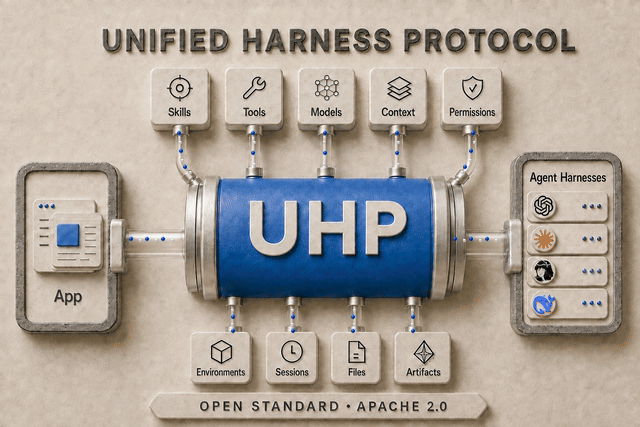

# 统一 Harness 协议（UHP）

**一项将完整智能体 Harness 作为共享基础设施运行的开源标准。**

UHP 提供通用转换层，连接智能体 Harness 与应用程序及围绕各 Harness 的模块，统一 Harness 与应用程序之间的接口，并统一技能、工具、模型、上下文、权限、环境、会话、文件和构建产物与各 Harness 的连接方式。

<p align="center">
  
</p>

只需集成一次，兼容 UHP 的模块、Harness 和应用程序即可通过同一份共享契约通信。UHP 以 Apache 2.0 许可证发布，可自由实现、扩展和构建。**借助 UHP，智能体 Harness 及其周边模块可成为真正的插件：通过一个统一接口，实现可移植、可互换、可跨应用复用。**

*Harness* 是完整的智能体运行时——一个负责规划、调用工具、编辑文件并回报结果的循环。Codex、Claude Code 和 Hermes 都是 Harness。它们各自都知道如何完成工作；但它们没有就产品应如何*驱动*它们达成一致：如何启动任务、跟踪进度、继续对话、取消任务、获取生成的文件，以及理解失败原因。

如今每个产品都要针对每种 Harness 重新回答这些问题。UHP 只需回答一次。

```
   你的产品 ──▶ UHP ──▶ ┌── Codex
                        ├── Claude Code
                        ├── Hermes
                        ├── DeepSeek Harness
                        ├── Gemini CLI
                        ├── Pi
                        ├── ...
                        └── 下一个发布的 Harness
```

UHP 不是模型 API，也不替代模型 API。模型 API 给你一个*轮次*：输入消息，输出 token，工具需自行运行。UHP 给你一个*任务*：输入工作内容，得到一个运行中的智能体，它使用自己的工具、维护自己的会话，并交回结果和文件。交换单位是作业，而非补全。

## 本文档状态

| | |
|---|---|
| **当前版本** | `2026-10-04` |
| **状态** | 草案标准——足够稳定可供构建，已版本化以便安全变更 |
| **规范** | [`versions/2026-10-04/`](versions/2026-10-04/) |
| **机器可读** | [`schema/`](schema/) — OpenAPI 3.1 + JSON Schema 2020-12 |
| **一致性测试套件** | [`conformance/`](conformance/) — 可运行，且是"一致性"的定义 |
| **变更流程** | [`GOVERNANCE.md`](GOVERNANCE.md) |
| **版本规则** | [`VERSIONING.md`](VERSIONING.md) |
| **许可证** | Apache-2.0，与仓库相同 |

## 无需托管服务

UHP 是一份 HTTP 契约。一致性服务器是指任何能按本规范中的请求返回本规范中响应的服务器。它可以在容器、子进程、队列或他人的基础设施中运行智能体。线格式不要求托管服务、账户、许可证密钥或回传——一致性服务器可完全运行在你自己的机器上，使用你自己的提供商密钥，将所有数据存储在你自己的卷上。

按本规范编写的客户端可与任何通过一致性测试套件的服务器配合工作，无论由谁构建。[示例](IMPLEMENTATIONS.md)页面列出了目前基于 UHP 构建的服务器和客户端。如果你发现客户端依赖的某个行为规范未描述，那是规范缺陷——请[提交 Issue](https://github.com/HarnessRouter/harnessrouter/issues)。

## 协议涵盖内容

| 章节 | 定义内容 |
|---|---|
| [架构](versions/2026-10-04/architecture.md) | 角色、一致性类别和对象模型 |
| [生命周期](versions/2026-10-04/lifecycle.md) | 版本协商、能力发现、任务生命周期 |
| [Harness](versions/2026-10-04/harnesses.md) | 发现、选择和配置 Harness |
| [插件](versions/2026-10-04/plugins.md) | 工具和技能包，作为一个单元安装到 Harness |
| [环境](versions/2026-10-04/environments.md) | 项目的文件和已安装依赖，构建一次，在引用它的每个会话中只读 |
| [记忆](versions/2026-10-04/memories.md) | 比会话更持久的记忆：记忆树、按节点访问、记录、召回、提供者 |
| [任务](versions/2026-10-04/tasks.md) | 发送工作并接收结果 |
| [流式传输](versions/2026-10-04/streaming.md) | 实时跟踪进度 |
| [会话](versions/2026-10-04/sessions.md) | 继续对话和取消对话 |
| [文件](versions/2026-10-04/files.md) | 发送文件、获取构建产物 |
| [错误](versions/2026-10-04/errors.md) | 失败分类、重试和幂等性 |
| [安全](versions/2026-10-04/security.md) | 实现者必须做对的事项，集中一处 |
| [Schema](versions/2026-10-04/schema.md) | 机器可读定义及其使用方法 |

## 快速了解

发现服务器能运行什么、运行任务并跟踪它：

```bash
curl -s https://your-uhp-server/v1/harnesses -H "Authorization: Bearer $KEY"

curl -s -N https://your-uhp-server/v1/responses \
  -H "Authorization: Bearer $KEY" -H "Content-Type: application/json" \
  -d '{
        "input": "Summarise README.md in three bullets.",
        "model": "claude-sonnet-4.6",
        "metadata": { "harness_id": "chrn_…" },
        "stream": true
      }'
```

流是 Server-Sent Events。最后一个事件携带完成的 `response` 对象，包括智能体生成的所有文件。要继续同一对话，发送下一个请求时将 `previous_response_id` 设为你刚收到的 id。

完整演练：[任务](versions/2026-10-04/tasks.md)。

## 与 OpenAI Responses API 的关系

UHP 的任务接口刻意设计成 OpenAI Responses API 的形状，一致性服务器必须接受[任务](versions/2026-10-04/tasks.md)中描述的请求体子集，并发出[流式传输](versions/2026-10-04/streaming.md)中描述的事件词汇表。

这是兼容性决策，而非偶然。产品已有能理解 Responses 的代码；现有 SDK、流解析器和 UI 组件无需修改即可对接 UHP 服务器。UHP 增加的是 *Harness* 需要而模型端点没有概念的一切：由哪个 Harness 运行工作、其工具和技能、任务间存活的会话、返回的文件，以及取消已在运行的工作。

UHP 扩展 Responses 接口时，只在有文档记录的、增量的地方扩展——`metadata`、少量额外请求字段和额外对象类型——绝不改变现有字段的含义。忽略所有 UHP 扩展的客户端仍能获得可用的任务。

## 实现 UHP

1. 阅读[架构](versions/2026-10-04/architecture.md)并选择一致性类别。
2. 从 [`schema/uhp-2026-09-12.openapi.yaml`](schema/uhp-2026-09-12.openapi.yaml) 生成类型。
3. 构建期间对服务器运行[一致性测试套件](conformance/)：
   ```bash
   pip install -e protocol/conformance
   uhp-conformance --base-url https://your-server --api-key "$KEY"
   ```
4. 发布报告。通过某类别测试的服务器可自称为"UHP 2026-09-12 一致性（<类别>）"。

两份面向角色的指南按顺序讲解：
[实现客户端](CONNECTING.md)——发现、任务提交、事件处理和构建产物获取——以及[实现服务器](SERVING.md)——服务器应答的操作及如何连接一个或多个 Harness。

## 贡献

对本规范的变更遵循 [`GOVERNANCE.md`](GOVERNANCE.md)。简版：先用文字提案，且除非规范、参考实现和一致性测试套件同步推进，否则变更不予合入。

## 背景

关于名称背后的故事、权衡过的替代方案，以及为何 *Unified* 赢得了 UHP 中的字母 U，见[背景：UHP 的命名](naming)。

## 官方网站：
[unifiedharnessprotocol.org](https://unifiedharnessprotocol.org/)